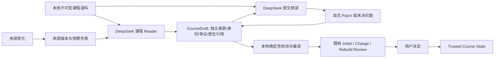

# Syllab v0.3.0 AI 工作流独立技术审查

日期：2026-10-10，Asia/Singapore。范围：canonical local repo 的当前未提交代码、产品与技术文档、E2P-041，以及已有真实请求、原始 SSE、响应与失败。基准 HEAD 为 `26426a3793250aea351c443e3327ccdb1b95b697`；HEAD 不是当前代码的完整快照。

审查期间新增模型调用 0，费用 0；没有改动生产源码、构建、真实课程状态或既有账本，没有采用候选、commit、push 或发布。应用户要求，本审查及脱敏证据摘要随后写入 Google Drive Desktop 同步目录，并通过本地读回校验。这是一份技术判断和可复核证据，不能作为新架构已经达到语义验收的声明。

可共享的复核结论见[脱敏证据摘要](../../../artifacts/v0.3.0/independent-ai-review-20261010/AUDIT_PUBLIC.json)。完整离线审查器和逐文件输入哈希保留在 canonical local repo 的 `artifacts/v0.3.0/independent-ai-review-20261010/`，因为审查器读取私有保存材料，而完整结果会列出私有证据路径；这些文件不进入 Drive。审查从真实 request 重建投递范围，从原始 SSE 重拼内容、finish 与 usage，并与保存 capture 比对；没有将课程原文、SSE 或推理复制到脱敏摘要。私有输入文件数不代表独立课程数量。

## 结论

主要问题是：系统在模型理解前没有稳定交付完整上下文，在模型理解后又多次改变语义表示，而验证主要检查引用与清单是否闭合，最后的数据模型还可能把未决条款变成确定要求。它没有让一个连续的课程理解结果贯穿到 Review。

因此，不应继续以“给旧合同增加一层清单、一个 Prompt 禁令或一次完整重生成”为主要路线。最值得实施的是：**以完整课程语料为输入，建立一个能保留独立条款、适用性、争议和来源的 CourseDraft；由本地确定性编译到既有 Review，再按来源与事实依赖做增量更新。** 用原文核读来检查这个草稿；减少重复生成相同结论的阶段。

这保留 Local-first、BYOK、`deepseek-flash`、Evidence、Human Review，也保留 Same / Different / Uncertain 和全部既有变化类型。需要替换的是内部理解、聚合与候选表示，并非产品信任边界。

这也不等于“单次全文 Prompt 已被证明足够”。现有证据支持用更接近直接阅读的方式建立课程理解，但同样证明：全文已发送、JSON 完整、ID 全覆盖，仍然可以丢义。必须同时重做语义表示与输出到 Review 的投影。

## 证据如何使用

审查没有把 Engineering Report 的 PASS 当成事实终点。脚本从真实 request 重新重建投递范围，从原始 SSE 重新拼接内容、finish 与 usage，再与保存的 capture 比对。052 的 41 份有 usage 的响应全部一致；另有 2 份传输未验证，保留 UNKNOWN。048 多来源 Plain / Lean 的两份原始 SSE 也与保存正文一致。

当前源码默认开启 `directCourse: true`，见 [background/index.ts](../../../extension/src/background/index.ts)。当前新工作流绕过旧 Task A，然后执行分批原生提取、全局 B，以及 Check 时的比较 C。旧 A→B1→facet→synthesis 仍是历史工作流与对照证据，不能把其所有缺陷直接说成当前路径仍在执行。

E2P-041 的“v8 到 Review、人工语义失败；v9 离线防漏、没有付费复验”与原始证据相符。公开 `UNPACKED_EXTENSION.json` 的 runId 是较早的 `052b:final`；`PRODUCTION_BROWSER.json` 也是早期范围。它们不能证明最新 v8/v9 的整体产品验收。此次纯函数投影也不是新的真实浏览器验收。

下面区分三种结论：原始运行已观察到的事实；通过当前代码离线重放证实的机制；仍需要公平模型实验验证的方案收益。

## 根因一：可访问的材料没有等于实际交付的材料

对 049 的 20 份真实请求重新计算原生文本范围并去重：

| 范围                                |  实际原生字符 |
| ----------------------------------- | ------------: |
| 11 Sources / 236 units 原始可读内容 |       125,574 |
| Task A 初投                         |        49,020 |
| Task A 所有请求唯一投递             |        55,584 |
| 整条链所有请求唯一投递              | 58,391，46.5% |

这是请求文本暴露比例，不是模型理解率；quoted Evidence 不重复计入 native text，传输未验证的 request 1 也不被宣称已理解。数字与旧报告一致，但本轮从请求重新得到。

真正的系统性原因见 [course-read.ts](../../../extension/src/v2/course-read.ts:39)：附件只 bootstrap 第一单元，其余靠模型 requestedReads。没有读到后面的关键条款时，后续阶段只能处理已经准入的 Draft 与 Group，不能凭空补齐完整课程事实。

更严重的是工具协议容易产生合法但几乎无用的读取。request 3 的两个 range 实际各取 33 字符；request 10 取 66 字符。这些是原始 request / delivery 中的真实 start/end，并不是模拟的小范围。Local 的字符切片正确，但模型并未得到整页。

续读 request 3、7、10 都只有 system 与本次 user 两条消息：`carry:null`，此前 authored carry 只通过 carryRef 暴露，分别为 5,367 / 6,443 / 6,785 bytes。模型必须再主动请求它，不能把持久化到本地当成模型自动拥有的上下文。对应代码是 [architecture-runner.ts](../../../extension/src/v2/architecture-runner.ts:186)。表格 S04 初轮拿到 row 1 表头，续轮拿到全部 row 2–4，却在最终 sourceCoverage 中漏掉 row 1，遭 `SEMANTIC_COVERAGE:LOCATOR_MISSING`。

**判断：旧链的一部分“理解失败”首先是阅读与连续工作状态失败。** Read-on-demand 是必要能力，但不宜承担全部未知重要信息的首次发现；让模型自行操纵字符偏移、搬运工作状态和复述整份 coverage 清单，是不必要的额外任务。

## 根因二：合并在压缩内容，ID 对账没有保住意义

v8 实际交付 117 Sources / 978 units，输入 491,842 tokens，输出 33,660 tokens（含 reasoning 17,031）。原始流 `stop`、DONE、usage 齐全。它的 211 条 claim ID 完整通过 inline accounting，却仍然丢掉动作。

可复核的路径：

```text
.../direct-runs/052:production:direct:isolated-native-052c:final-exact-clause-v8.request.json
  messages[1].content.claimAudit

对应 .json
  capture.raw.output.canonicalAssessmentProposals[0].requirements
```

这些文件位于 `evidence/private/goal-driven-052/`，脚本输出的 `v8.lossWitnesses` 保存具体 claim / requirement 索引。

| 上游条款                                                                                              | 最终选择                   | 结果                                                      |
| ----------------------------------------------------------------------------------------------------- | -------------------------- | --------------------------------------------------------- |
| claim4：识别主动/被动 stakeholder，并创建 Power-Interest Grid；claim6：Gantt 需展示任务、时长与依赖等 | claim66：章节/小节结构清单 | 多条 claim 被声称已经处理，但详细动作和 dependencies 消失 |
| claim20：全部组员在分配时段到场，存在问题可提前联系                                                   | claim19：检查音视频设备    | 出席与联系被映射到设备检查，未成为学生可见的完整条款      |
| claim15：组长可导航幻灯片                                                                             | claim14：安排成员发言顺序  | 许可随合并丢失，`navigate` 不在最终语义正文中             |

这里检查的是最终 field/requirement/rule/issue 正文，不把藏在 Evidence 长引文中的词算成已经向用户表达的要求。原生引用只是包含相关材料，并不能保证最终语义节点传达它。

也不能机械地把所有 alias 差异计成整份答案遗漏。例如 claim159 的 appendix 许可不在所选 claim158 中，但 v8 的 slide_count 字段另外保留了该许可；Zoom 也在 schedule 字段中保留。本轮分别记录“映射丢义”与“其他字段是否仍有表达”，没有把四个映射 witness 算成四个独立全局漏项。v8 还保留了 16 组 slot、附加材料上传和部分章节分钟数，这些实际改善不能抹去。

当前 v9 [direct-claims.ts](../../../extension/src/v2/direct-claims.ts:60) 能拒绝该保存响应，离线得到 `DIRECT_COURSE:CLAUSE_ALIAS_LOSS`。这个 guard 应保留到替代路径具备同等安全能力。**但它证明的是旧答案被识别出损失，不是新模型已经更好地理解。** 将全部 reconciled IDs 逐字拼接也会带来重复、旧版本条款和冲突值并列；上游 AI 改写本身还可能错误。单纯守住字符串，不等于形成正确可用的课程理解。

**判断：需要保存独立意义与来源，不能让最终摘要成为唯一事实载体。** 合并应该建立等价、冲突、作用域关系；不应以一个更短的 topic 摘要代替若干动作，再以 ID 数量证明无损。

## 根因三：事实、要求与争议没有使用一致的语义状态

v8 中 case-study 的 `time_limit` 为 UNCERTAIN，候选有 1 与 3 小时；exam 的 `time_limit` 也为 UNCERTAIN，候选有 2 与 3 小时。但它同时输出确定措辞的“一小时 case study”与“两小时 exam”Requirement。

[assessment-output.ts](../../../extension/src/v2/assessment-output.ts) 对 field 验证 KnowledgeState，Requirement 却只要求 id、content、Evidence。[materialize.ts](../../../extension/src/v2/materialize.ts:514) 无条件把每个 Requirement 写成 KNOWN。

本轮用历史 v8 解码结果调用当前纯 materializer，得到这两条 duration Requirement 均为 KNOWN。这是隔离的机制复现；没有绕过当前 v9 guard 将 v8 写入生产。它说明即使 AI 在一个字段认识到争议，另一个语义表示仍能把相同信息重新变成确定事实。

同样，规范力度不能只依赖散落在段落里的 should/can。049 的全文 S02 将“可自由联系”强化为“should 提前提出”；后面的 native facet 核读又纠正为 permission，synthesis 保留 optional。这是额外核读确有价值的真实正例，不能因为流程重就把核读全部撤掉。

**判断：可信性要求统一的事实与条款模型，并保留原文核读。** 必需的是 applicability、normative force、condition、exception、conflict 及其影响范围；不必让它们在 Draft、Inventory、Facet、Requirement、Issue 五种表示中反复重新生成。

## 根因四：让模型实现数据库和协议，增加了非语义失败

052 共有 43 条派发记录；41 条有已知 usage，2 条传输未验证。41 条完整响应中，14 条在 JSON 或合同准入被拒绝，全部 finish=stop。这是同一课程的反复探索与修复记录，不能解释成生产稳定失败率；但它明确排除了“这些失败全部因为输出截断”。

旧链要求模型同时维护 Registry CAS revision、parent/source-qualified IDs、输入 disposition、locator coverage、facet routing、语义轮/transport 轮和 carry。049 的两个最终 facet 因 PARENT 被拒绝；部分完整内容因 coverage 行缺失不能准入。当前 direct 链仍让分来源捕获生成完整 TaskB proposal，随后再供全局候选重生成。

v8 的 system 有 15,905 字符，user 有 1,811,901 字符；同一次全局请求同时包含 native Sources、约 165k 字符的 preceding parts、约 95k 字符的 claimAudit。信息重复不全是无用内容，但相同事实的多种改写成了额外的冲突与错误入口。

048 提供了更接近公平的观察：Plain 与 Lean 的 multi-source user 内容 SHA 相同，模型、thinking、effort 等参数相同；system 和 response_format 不同。原始 Plain 正文表达了 Power-Interest Grid、Gantt、appendix、全员到场；Lean 的 Requirement content 没有这些表达，前两项仅留在 Evidence 引文里。旧人工 provisional worksheet 的总体数字是 Plain 41/43、Lean 确定正确 29/43；这不是本轮新评分，也不是 Human frozen gold，更不是跨课程准确率。

**判断：任务形式确实能影响什么进入最终答案；模型能力不是唯一解释。** 现有样本尚不能量化复杂合同对所有失败的因果占比，也不能推导“任意 JSON 都比自然语言差”。应减掉模型不必承担的机器工作，使用一个短且稳定的语义协议，让本地封装存储与传输合同。

## 根因五：Review 的覆盖与可用性不是同一件事

[direct-review.ts](../../../extension/src/v2/direct-review.ts:20) 将所有课程级 issues、每 Source limitation 和 identity uncertainty 拼到每个对象；还把全课 issue Evidence 挂到每个对象。它们没有统一的 affectedObject / affectedFact 关系。

本轮将历史 v8 的已解码语义值通过当前纯 materializer / Review projection 重放：14 个 Review item，每项 97–98 条 unresolvedQuestions，总计 1,359 次出现，只有 98 条不同问题。这是纯函数投影结果，不是新的 DOM 截图或当前真实课程状态。源码 UI 会逐条 render unresolvedQuestions，没有语义筛选。

同时，一个遗漏的动作根本不会产生 Fact 或 Review item。事实、Evidence 或 DOM 数量守恒只能证明传递了已有结果，不能证明原文中的所有重要意义都进入了 Review。将全部全局疑问复制到每个对象，也不能代替正确处理已知争议。

**判断：Human Review 是最终信任边界，但不能承担重新阅读全部课程资料并找出 AI 未生成的事实。** 要让 Review 接收完整、有状态、作用域明确的候选；全课风险保持可见，并与受影响对象关联，而不是淹没每张卡。

## 根因六：当前增量只在“完全无变化”时轻，在有变化时仍很重

当前代码确实有 unchanged-course 的零 AI fast path，应保留。[workflow.ts](../../../extension/src/v2/workflow.ts:1421) 比对 delivered native snapshot，无变化时可以结束 Check。

但一旦进入 directTaskB，它读取全课 Sources，按 128 KiB 默认物理目标重新批量 sourceCapture，再生成全课 B，最后做 C。`prepareDirectCourse` 的 snapshot 对整个 `input` 取 digest，包含 SourceRecord 的 `updatedAt`、`lastFetchedAt` 等本地运行时间；fetch 又刷新这些字段。

本轮逐批构造“正文、metadata 和实际投递完全相同，只改变本地抓取时间”的离线反事实：13/13 个 sourceCapture snapshot 都改变。也就是说，有变化的 Check 在重新抓取所有 Sources 时，内容完全未变的批次也可能无法复用。这个机制已在当前代码证实；没有把它说成已经观察到的新真实 changed-source Check 结果。

C 还让模型重述本地 CurrentValue 和 CurrentEvidence。真实 comparison-v2 的输入有用户编辑权重 41%，模型却返回 currentValue 40%，并声称有当前 Source Evidence。准入正确拒绝，可信状态没有被覆盖。比较任务输入仍为 546,812 tokens。

**判断：增量的基本单元应是来源版本与有语义依赖的事实，不应是整课的重新表达。** CurrentValue 这种本地权威值无需模型复述；模型只应判断旧事实与新候选之间的语义关系，本地按引用复制真实值与来源身份。

## 哪些复杂度要保留，哪些应替换

| 保留的能力                                                                | 原因与实现边界                                             |
| ------------------------------------------------------------------------- | ---------------------------------------------------------- |
| immutable Source / representation hash / Locator / exact Evidence         | 支持查证、更新与恢复；字面定位不被当成语义支持证明         |
| Local-first、BYOK、DeepSeek 生产模型、访问字段脱敏                        | 产品边界；不把资料、Key 或推理转到新的共享后端             |
| AI 的 relevance、identity、ownership、conflict、removal 判断              | 本地不按文件名、年份、词相似或 absent 推断课程事实         |
| provisional / trusted 隔离与全部 Human Review 决策                        | 只有合法用户 adoption path 可改变可信课程                  |
| durable dispatch / usage / UNKNOWN reservation / lease fencing / recovery | 防止重复收费、旧结果覆盖、新旧 workflow 混用；由本地执行   |
| native text、表格结构与 scoped visual completion                          | 真正的完整资料阅读能力；缺失范围必须明确                   |
| 原文核读与语义回归                                                        | 已有纠错收益；评估独立动作、许可、禁止、条件、例外与作用域 |

| 替换或减少的复杂度                                | 替代方式                                                                                |
| ------------------------------------------------- | --------------------------------------------------------------------------------------- |
| 仅第一页 + 自行猜 range 的初次阅读                | 全量原生文字顺序交付；粗粒度 read_page / read_section / read_table；精细 range 留给定位 |
| carry 只给引用，模型自行搬回状态                  | 自动带入实质工作状态与必要的已读上下文；本地保存完整记录                                |
| Draft→Registry→Inventory→Facet→Proposal 每次重述  | 一个 CourseDraft，来源观察与最终事实之间有明确引用关系                                  |
| 模型维护 CAS/revision/机械 envelope/coverage 总表 | 本地持有协议状态、派发与技术投递账；模型只输出语义内容与已有引用                        |
| 13 次 mandatory 完整 TaskB 提取再整课合成         | 全课 Reader 为主；资料超过实际窗口时才做有连续状态的物理分段                            |
| 完整重生成作为普通修复                            | 隔离受影响对象的 patch / audit，保留所有有效 siblings                                   |
| 多 claim→单 summary 被视为无损                    | 独立条款保存；AI 表达等价/冲突/适用性，摘要不取代事实                                   |
| 全课 issues 无差别复制                            | 有 scope 与 affectedRefs 的 issue 图，编译到既有 Review                                 |
| 抓取时间驱动缓存、Check 再解释全部 Sources        | 内容与相关 metadata 版本驱动 SourceNotes，依赖图决定确定性的失效范围                    |
| C 复述 CurrentValue/Evidence                      | 只引用 currentFactId 与 latestCandidateId，本地绑定权威值                               |

不建议立刻删除历史模块或改造 22 表。旧 session 应按原 prompt/schema/snapshot 恢复；新的策略经过隔离验证再取代新工作流的默认入口。

## 推荐架构：课程阅读、CourseDraft、本地编译、按依赖更新



### 1. 课程语料先成为可读材料

保留完整 raw Source。给模型的主视图是 authored body、标题/层级、完整 PDF/PPTX/DOCX/XLSX 单元，以及明确区分的原生课程配置、日期、grade settings 和 provenance。未知 schema 字段保留在单独原始 metadata 层并可读取；不以本地词义决定重要性，不删掉看似旧的材料。

当前请求中原生对象/announcement 共约 987k 字符，附件约 350k；body.displayText / rawText 的重复与全部 platform scalar flattening 增加噪声。应使用格式与 Blackboard schema 的确定性投影，避免把 transport / UI 状态与 authored course policy 混成一段正文。不能直接把“只发 body”当成完成，因为 native grade/date 配置仍可能重要。

同字节内容可用一个 content blob + 多 Source origin 保留，不能因为内容 hash 相同就合并 Source 身份、学期或适用性。Source aliases、原始标题、相关 metadata 与各自版本都仍交给 AI。

v8 的 852 个附件 unit 标记 visualGaps，直接请求却有 0 个 image part。这里可能包含文本已充分表达的图形，也可能有重要未读图表，现有证据不足以逐一判定。主路径必须支持 scoped visual read，并分别记录“文本送达”“视觉未读”“AI 声明核读”“语义验收”；不能把输入 token 多等同完整附件阅读。访问 URL 被脱敏也不等于 authored body 缺失，应分别描述。

### 2. 用一个语义草稿承接模型理解

Reader 从课程整体建立活动、规则、条款、适用性和争议；同时接收完整上下文，不预先把它限制在错误的 Group 身份中。正常课程以一次完整语料 Reader 为首选；无法满足实际 context / payload / 输出条件时，按完整 native 单元分段，自动携带已有草稿和已读关系，直到所有可读文字已交付或明确记录不可用。物理波次不是语义权威边界。

以下是需要实现的最小内部表示，字段名只是方案草图，并非已锁定 API：

```ts
type CourseDraft = {
  entities: EntityCandidate[]; // AI 决定 assessment/component/rule 与身份
  observations: SourceObservation[]; // 来源局部解释，始终为未受信候选
  facts: SemanticFact[]; // 一条独立意义，不是一个章节标题
  relations: SemanticRelation[]; // equivalent / conflicts / supports / scope
  issues: ScopedIssue[]; // affected entity/fact/source refs
};

type SemanticFact = {
  id: string;
  ownerRef: string | null;
  kind: "field" | "requirement" | "rule";
  content: string;
  state: "KNOWN" | "UNCERTAIN" | "EXPLICITLY_UNKNOWN";
  modality?: "obligation" | "prohibition" | "permission" | "recommendation";
  condition?: string;
  exception?: string;
  applicability: { state: "CURRENT" | "UNCERTAIN" | "NOT_APPLICABLE"; reason: string };
  evidenceRefs: NativeSpanRef[];
  observationRefs: string[];
  conflictRef?: string;
};
```

关系与 state 必须由 AI 语义判断产生；Local 验证已有引用、类型和明确关系的一致性。不要把一个 `NOT_APPLICABLE` 历史义务拼进当前要求，也不要用来源局部 observation 的措辞强迫全局接受。解释可以长，协议应短；需要的信息比字段种类更重要。

Reader 返回轻 JSON 的语义正文与 source refs；Local 生成持久 ID、request envelope、投递账、存储 provenance。快照与 lease 由本地绑定原始请求，不靠模型复述 digest 或 CAS revision 达成安全。引用实际存在、指向本次授权材料仍须严格检查；模型不能任意指定持久数据库目标。

### 3. 原文核读处理风险，不再重写全部结论

使用同一生产 DeepSeek，对原文与草稿做第二次核读：独立动词、许可/禁止、条件/例外、附件交付、每组时段、结构身份、不同来源权重/日期/时长及当前适用性。核读输出遗漏、无支持、作用域错误和冲突的显式 patch；保留未决，不能靠选择一个“更合理”值过关。

核读是来源优先，不是检查现有 claim ID 是否齐全。对于大语料，Reader 可生成来源阅读计划与风险范围；所有可读文字的技术交付仍由本地记录，模型决定补读和语义范围，不由本地关键词筛选。

初始目标是一个 Reader 加一个核读逻辑任务，不是新的固定“两次收费上限”。分段、补读与 patch 的实际派发由真实窗口、无进展检测和用户费用预算约束；不填入新的任意容量数字。同模型核读存在相关错误，不能把两次一致当成 Human gold 或安全证明。

### 4. 本地编译必须对语义内容和状态透明

一个 compiler 将草稿映射到现有 Assessment、Constraint、Fact、Evidence 和 Review：

- 使用 AI 指定的 owner / relationship，不做本地语义归属。
- 完整条款保留为事实；用于概览的 summary 是派生展示，不能替换它。等价原文可以收在同一事实的支持中，非等价动作保持独立。
- Requirement 也有自己的 KnowledgeState；AI 显式关联某条款与冲突后，该条款不能通过另一通道成为 KNOWN。校验不一致时拒绝受影响对象、保留未决，不由 Local 选真值。
- Evidence 引用定位到源版本与短 span；整页包含这个主题仍不足以证明一条要求。保留邻近表头、条件与例外上下文，避免截句失真。
- source/visual gap 与 semantic issue 分开；AI 指定 affectedRefs。课程级问题保留在既有可见范围，有关问题才进入对应对象。涉及 UI 可见意义或文案变化须 Product 定稿，不偷偷删警告。
- 全部通过与明确 Partial 分开；有效 sibling 可保留。对无法解析的整体语义响应保持失败，不把无效 JSON、断流或截断答案修成完整验收。

旧 Review 的 Confirm / Edit / Exclude / Split / Same assessment as…、Change acceptance / Keep Current、Possibly Removed、Rebuild Use / Keep 均保留。先证明新 compiler 能表达完整结果；若现有 UI 无法呈现必要状态，应明确形成 Product 决策，不能将状态塞进普通正文后宣称已经支持。

### 5. 增量从事实依赖开始

分开三种身份：native content/context version、execution/workflow identity、trusted semantic object identity。本地抓取时间和 lease 不能作为语义内容变化。SourceNotes 的 cache key 包含 content、会影响语义的原生 metadata、parser/representation 版本、prompt/schema 版本；不包含 lastFetchedAt 等运行时钟。

持久化 Source→observation→fact→entity 的依赖。Local 按已有图求失效闭包；AI 判断新材料影响谁、是否 Same / Different / Uncertain，必要时扩大范围。新来源没有已知依赖时，也需一次课程对象目录的 AI 影响判断，不能因图里没有边就跳过。

修改课程 outline 可能影响全课；修改一个提交日期通常只需读变化来源、相关事实与其争议来源。整课 rebuild 仍保留，用于无法安全限定范围时。覆盖不足永远不允许把 absent 当作 removal。

C 输出 currentFactRef / latestCandidateRef、changeType、judgmentBasis、support refs；Local 从 trusted store 复制 CurrentValue 与用户修改 provenance。新值的 Evidence 来自已经通过来源校验的候选，人工值不被伪造为 native Source 支持。这个设计直接消除真实 41%→40% 回显错误的机会，同时仍让 AI 决定 meaningful change。

## 实施路径与成本依据

先做新策略适配器，不先迁移可信状态。建议模块边界为 corpus preparation、CourseDraft contract、course reader/auditor、deterministic compiler、incremental impact/comparison；复用已有 DeepSeek transport、IndexedDB、staging、Review reducers、权限/预算/lease fences、Activity 和恢复。不要再叠加一个新的独立 Registry/facet 框架。

第一步离线实现 contract/compiler 和 evidence round-trip，拿保存的完整原生材料及旧输出验证：独立动作不会因 merge/ref 解码消失；争议状态不能被 Requirement 绕开；手动值只能由本地权威引用获得；scope issue 不再无差别复制；仅抓取时间变化不会失效语义缓存。这一步可零付费，但不能证明新 Reader 语义质量。

第二步在隔离 workflow 中接通新策略，保留现有生产成果与旧恢复入口，再做同信息条件的模型实验。不是把 v8 改成新答案，而是新架构产生新候选，再用相同冻结材料、同一模型、完整投递范围、相同产品语义要求比较。当前用户明确禁止新付费调用，本轮只给出判据。

已有实测可以确定成本问题的规模：13 个最终准入 sourceCapture 的 input 合计 460,191 tokens，output 226,730 tokens（其中 reasoning 171,977）；加 v8 全局合并，input 共 952,033 tokens。对应成功调用耗时合计 970.145 秒，约 16.2 分钟；这是跨既有试验取得的成功组件之和，不是一个连续生产 E2E 用时，不含失败修复、Check、解析或等待。

按本轮核实的官方 peak USD 费率，这些 13+1 组件约 $0.5890，单 v8 约 $0.1872；off-peak 为对应的一半。这是场景估算，不是人民币钱包发票，不把未知费用清零，也不将实验 43 次的总费用当成正常初扫成本。v8 缓存命中仅 2,688 / 491,842 tokens，不能假设多轮近乎免费。[DeepSeek 模型与价格](https://api-docs.deepseek.com/quick_start/pricing/)

新架构的主要成本收益应来自去掉 13 份重复完整 proposal 的强制生成、缩短机器协议、复用内容版本及缩小 changed-source 影响范围。不能在新请求尚未实测时承诺节省比例或固定时延。衡量必须包含初扫与多次维护，而不仅是一份简短答案的单次价格。

官方文档当前确认 `deepseek-flash` 的 1M context 和 384K 最大输出；旧代码的容量并非本次 v8 丢义的直接证据。足够的物理窗口不保证完整语义理解。JSON mode 面向格式输出，没有为 Syllab 的 owner、modality、等价关系或语义完整性提供保证。[DeepSeek JSON Output](https://api-docs.deepseek.com/guides/json_mode/)

继续用现有 JSON requestedReads 还是 provider native tools，可以在同模型协议验证后决定；它不是本次根因修复的前提。若采用 native tools，必须遵守官方 thinking/tool 对话状态要求，不能只传一条最新 tool 结果。[DeepSeek Thinking Mode](https://api-docs.deepseek.com/guides/thinking_mode/)

## 验证标准与判断边界

保留现有 gold；54 条中原有争议须独立 Human 裁决，不能改 gold 来替新架构过关。对工程 provisional 与正式 gold 分开评分。新架构先在已有材料做公平对照，再在不同课程和不同文件结构做 holdout；目前只有一门已见课程，其内部拆分不是跨课程泛化。

验证至少分开记录：

1. **信息交付：**全部 authored 文字、表头、上下文、已请求视觉与不可用范围；actual request manifest 和 source spans 为准。可访问与已发送分开。
2. **语义：**当前/历史适用性、assessment/component/rule 身份、每个独立动作、modality、条件/例外、所有时段、权重/时长/日期冲突；Evidence literal 与 support sufficiency 分开。
3. **候选到 Review：**每个 semantic fact 的正文、state、关系、source scope 到显示/用户决策的逐项一致性；UI 出现一张卡、N 条 Evidence 或 DOM 文本数量相同都不足够。
4. **维护与运行：**无变化零调用；时间刷新缓存守恒；真正来源变化后的 New/Changed/Conflict/Uncertain/Removal；用户编辑/排除保护；重启、断流 UNKNOWN、恢复与费用；在隔离 Chromium 证明真实 Engine→IDB→Review。

关键消融要检验完整投递、轻合同/本地 envelope、单一语义草稿、原文核读、按事实依赖增量各自的净收益。新 Reader 与旧链必须按实际交付的同一资料比较；资料暴露不同的结果只能用于读机制诊断。最终 compiler/Review 对照以原生 source-first 条款为单位，不能只对模型自行生成的清单做守恒。

现有证据已经足够否定“工程合同闭合即可宣布语义完整”，也足够决定停止把反复全局重生成当成主路线。它尚未证明新 CourseDraft 架构能稳定达到优秀助手的质量。本轮的推荐是有具体失败机制、数据模型和接入路径支撑的替换方案；下一次实现应优先验证这个方案，而不是再用更多修复 Prompt 为现有表示增加一层账目。
