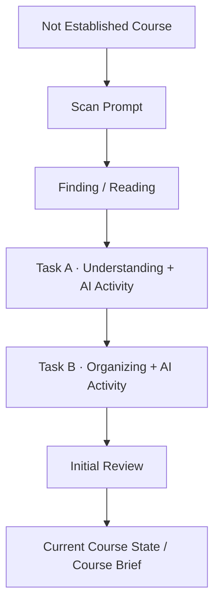
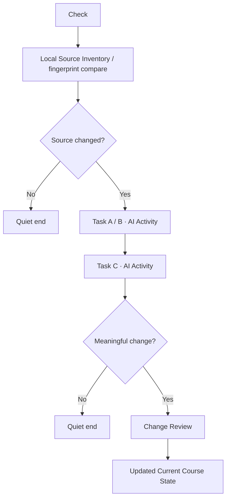
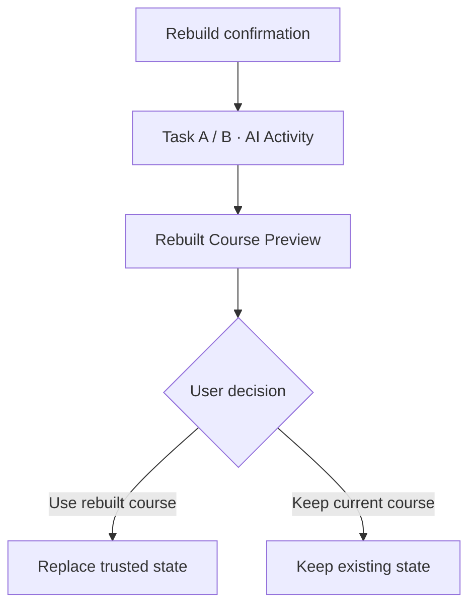

# Syllab for NTU Learn 交互与信息架构规范 v0.3.0

## P2E-056 RC2 页面及审核范围修订（已批准）

Course Brief 使用四层：考核总览与关键风险 → 每项考核的结构化执行清单 → Rubric/参考/来源说明 → 原始 Evidence。学生可直接找到权重、截止/考试时间、提交物与责任；父子、OR、例外及独立动作不因层级而丢失。教学建议和平台参数不占主层。

Initial/Change Review 提供目录、Previous、Next；导航不产生决定或 trusted 写入。Scheme 仅预览关联考核，本次批准只涉及明示的对象、字段和动作。独立重要未知/冲突继续待审。Edit 使用原始值，不含模型解释。Review later 保存 deferred 状态并选下一待审项；目录始终可返回。操作状态和保存失败必须可见，刷新后继续有效范围。

每次审核绑定对象 ID、Fact ID 与版本。不得让递归展示子考核看似纳入父级批准。380 与 1280 视口实际点击及保存/刷新是 RC2 验证条件；打印与屏幕分别检查。沿用现有导航及 Review，不新增一级 Evidence 页面或大型工作台。


**产品版本：** v0.3.0  
**文档状态：** Product Design Locked / Ready for Technical Design  
**设计定位：** 在 v0.2 已成立的页面、信息架构与交互逻辑上进行系统级统一与精修，不从零重设计。  
**语言规范：** 说明性内容以中文为主；Assessment、Review、Course Brief、Current Course State、Evidence、Task A / B / C 等已锁定产品术语保留 English。

> 本 Spec 负责 v0.3.0 的 Screen、Navigation、Information hierarchy、Interaction、UI state、AI Activity、Motion / Feedback、Side Panel / Full-page 行为与最终截图要求。  
> 产品范围、AI Processing、Task A / B / C、Shared Working Context、Evidence Ref、Evaluation 与 Acceptance 的产品级事实以 `PRD_v0.3.0.md` 为准。  
> 本版不新建独立 Screen Inventory，也不新建单独 UI Polish / Motion Spec。

---

# 1. 文档职责与设计基线

## 1.1 事实归属

从 v0.3.0 开始，Human-facing Core Product Archives 为：

1. `PRD_v0.3.0.md`
2. `VERSION_RECORD_v0.3.0.md`
3. `Interaction_and_Information_Architecture_Spec_v0.3.0.md`

本 Spec 只负责用户可见设计，不重新定义 PRD 已锁定的产品语义。

如果本 Spec 与 PRD 冲突：

> **以 PRD 为准，并标记 Product Conflict；不得为了 UI 方便静默修改产品逻辑。**

## 1.2 v0.3 不是重新设计

v0.3 的页面与视觉优化采用：

> **Preserve → Normalize → Refine**

### Preserve

保留 v0.2 已成熟的：

- Side Panel + Full-page 两个 Surface；
- Semester → Course 导航；
- Course Brief 为 Course 默认主体；
- Initial Scan / Initial Review / Change Review；
- Rebuild Preview → Use / Keep；
- Settings / Backup / Restore；
- Evidence 原位 Reveal；
- Assessment / Component / Series 层级；
- 现有 Product Mark、色彩气质与整体产品识别。

### Normalize

系统级统一：

- typography hierarchy；
- spacing / density；
- Assessment / Course card；
- primary / secondary / quiet actions；
- input / edit state；
- status / badge / mark；
- empty / waiting / failed / success；
- Side Panel / Full-page 同类组件；
- page header / back control / title alignment；
- interactive feedback；
- Motion behavior。

### Refine

对局部协调性、视觉密度、状态反馈、内容出现方式和页面转场进行精修。

目标不是“换皮”，而是：

> **第一眼明显更成熟、更协调、更顺，但仍能直接识别为同一个 Syllab。**

## 1.3 页面结构原则

v0.3 **不新增一级产品页面**。现有 Screen Family 继续成立：

- Semester / Navigation；
- Course State / Course Brief；
- Initial Scan；
- Initial Review；
- Change Review；
- Rebuild；
- Calendar Export；
- Settings / Data / Backup & Restore。

新增的是跨页面共享的 **AI Activity Region** 与完整的 **Interaction / Motion Feedback System**，不是新的产品入口或新页面。

---

# 2. 全局 Interaction / Motion Feedback System

## 2.1 核心原则

v0.3 的 Motion 不是装饰性动画，而是成熟产品中的连续交互反馈。

用户每一次主要操作，都应立即得到可感知反馈：

```text
用户输入
→ 即时视觉响应
→ 状态开始变化
→ 内容连续过渡
→ 新状态稳定
```

不得出现：

- 点击后长时间无视觉变化；
- 内容整块突然替换；
- 页面瞬间跳转且无空间连续性；
- 操作已生效但控件没有反馈；
- 同类操作在不同页面使用完全不同反馈方式。

## 2.2 必须覆盖的反馈类型

| 场景 | 必须有的反馈 |
| --- | --- |
| Button / clickable row | press / active / release feedback |
| Assessment open / close | container 与内容连续展开 / 收起 |
| Page / view switch | 有连续进入 / 离开反馈，不像硬刷新 |
| Fact ↔ Evidence | 原位内容过渡，保持空间关系 |
| Edit enter / save / cancel | 编辑态进入、保存成功、取消回退均有反馈 |
| Review Confirm / Accept / Keep / Exclude | 当前决策完成反馈 + 连续进入下一状态 |
| Status change | mark / color / text 状态连续变化 |
| New dynamic text | 自然 reveal，而不是整块突然出现 |
| AI Processing | Activity 持续更新，明确系统仍在工作 |
| Success / error / undo | 短反馈，不创建无必要完成页 |
| Side Panel / Full-page 同类操作 | 使用同一反馈语义 |

## 2.3 Motion consistency

具体 duration、easing、CSS / Web Animation 实现由设计落地与 Technical Design 固化，但必须满足：

- 使用少量统一 motion tokens，而不是每个页面自行决定；
- 同类状态变化使用同类 timing；
- 动效不能阻塞用户下一步操作；
- 动效不能掩盖状态变化；
- `prefers-reduced-motion` 下仍需保留完整信息和清晰状态反馈；
- 不添加与状态无关的装饰性持续动画。

## 2.4 视觉系统延续

v0.3 继续沿用现有 Folded Brief Product Mark 与现有视觉气质，不重新探索品牌方向。

现有 `docs/design-system.md` 作为视觉基线；v0.3 的目标是系统性校准与扩展，而不是另建一套设计系统。

---

# 3. AI Activity Region

## 3.1 定义

AI Activity Region 是所有长时间 AI Processing Working state 中的共享动态区域。

它解决的问题是：

> 单个 Task A 文件、Task B 组织或 Task C 变化比较可能持续较长时间；用户需要持续看到模型仍在运行，而不是只看到静态 Loading 或文件名。

## 3.2 内容来源

Activity **不额外调用 AI 做总结、解释或改写**。

直接从当前模型已有的流式内容中摘取最近少量内容：

- provider-exposed reasoning stream；
- output stream。

只做必要的确定性 UI 处理，例如：

- 截断；
- 最近内容滚动；
- 隐藏内部 ID / machine-only token；
- 控制最大显示行数。

不得为了 Activity 再启动额外 summary model call。

## 3.3 展示方式

Activity 是一个不断更新的轻量区域，而不是 AI Console。

示意：

```text
Understanding course information…

Course Outline.pdf

…checking assessment structure
…comparing related requirements
…identified Group Project
…weight: 40%
…linking supporting evidence
```

用户不需要逐字阅读；核心作用是持续感知“还在跑”。

## 3.4 Task A / B / C 一致使用

### Task A

可显示文件理解、文件内 Assessment Organization 过程中已有的 reasoning / output 片段。

### Task B

可显示跨 Source Assessment Identity / organization 过程中已有的 reasoning / output 片段。

### Task C

可显示 latest result 与 trusted Current Course State 比较过程中已有的 reasoning / output 片段。

## 3.5 产品边界

AI Activity：

- 不是 Review；
- 不是 Evidence；
- 不是 Current Course State；
- 不要求用户确认；
- 不作为正式课程事实；
- 不进入 History / Diff；
- 不因 Activity 内容而直接触发产品状态更新；
- 任务完成后自动消失或收起。

正式课程信息仍然只通过既有 Assessment / Review / Current Course State 产品层呈现。

---

# 4. Semester / Navigation 页面

本 Screen Family 沿用 v0.2 页面结构，不新增一级页面。

| ID | Screen / State | Surface | v0.3 处理 |
| --- | --- | --- | --- |
| `SEM-01` | Current Semester Dashboard | Full-page | 保留，做系统级视觉统一 |
| `SEM-02` | Current Semester Course List | Side Panel | 保留，统一卡片 / 状态 / feedback |
| `SEM-03` | Semester Switcher | Both | 保留，增强展开 / 切换反馈 |
| `SEM-04` | Historical Semester Dashboard | Full-page | 保留 |
| `SEM-05` | Historical Semester Course List | Side Panel | 保留 |
| `SEM-06` | Empty Semester | Both | 保留，统一 empty state |
| `SEM-07` | Not Established Course Prompt | Both | 保留 |

## 4.1 Navigation model

继续使用：

```text
Semester View
    ↓ Course
Course View
    ↑ ‹
```

- Full-page：Semester Dashboard；
- Side Panel：Semester Course List；
- Course View 左上角 `‹` 返回各自 Semester View；
- Semester name 继续承担 Current / Historical switcher；
- 不新增全局 Tab bar；
- Review / AI Processing / Task Status 仍然不是导航。

## 4.2 v0.3 视觉优化重点

- Course card 尺寸与内容密度更一致；
- 标题、课程代码、preview、status 的层级更清楚；
- Side Panel 与 Full-page 保持同一组件语言；
- hover / press / open / back / switch 均有连续反馈；
- 既有 alternate card rhythm 可保留，但整体对比与间距需要系统校准；
- 不改变 Established / Not Established 的业务语义。

---

# 5. Course State / Course Brief 页面

| ID | Screen / State | Surface | v0.3 处理 |
| --- | --- | --- | --- |
| `CRS-01` | Course Brief | Full-page | 保留，系统级精修 |
| `CRS-02` | Course Brief | Side Panel | 保留，同语义更紧凑密度 |
| `CRS-03` | Assessment Detail | Both | 保留，优化展开与动作层级 |
| `CRS-04` | Assessment Edit | Both | 保留，增强 edit feedback |
| `CRS-05` | Evidence Reveal | Both | 保留，强化原位 transition |
| `CRS-06` | No Assessments Found | Both | 保留 |

## 5.1 Course Brief 仍是默认主体

即使存在 Pending Review / Checking / Background AI work：

> **已有 trusted Current Course State 仍然优先可读。**

Processing 不得把用户锁在一个全屏 Loading 页面，除非该 Course 尚未建立且没有可展示的 Current State。

## 5.2 Assessment presentation

继续沿用 Assessment-centric 表达：

```text
Assessment
├─ Fields
├─ Requirements
├─ Components
└─ Series / Instances
```

v0.3 只优化：

- 视觉层级；
- 字体 hierarchy；
- spacing；
- field alignment；
- component / series 的父子关系表达；
- open / close / detail transition；
- action placement。

不重新定义 Assessment / Component / Series 产品模型。

### P2E-059：单一卡片与有序详情（2026-10-14，Human已批准）

覆盖上文仅视觉精修及P058双重展示实现的局部限制。Course Brief仅一套Assessment主卡：名称、适用weight/关键日期、考核或提交方式、交付与责任、重要限制/未决状态默认可读。选择同一卡进入既有CRS-03聚焦详情，返回同一套卡；不在页面下方另列同名完整大卡。类别仅作标签，Scheme只保留关系依据。

详情以提交/日期、考试或展示安排、准备/内容/行动、评分与重要问题组织；只出现相关栏目。已有父子树作章节/目录，长父原文、完整章节、Rubric/Reference进一步按需查证；不复制摘要字段。Independent、OR、条件/例外与力度可追溯，不把81条原文直接当已验证整理成果。旧模型未判清的业务分类/去重如实列为缺口。

Side Panel与Full-page使用同一对象/Fact/审核范围。卡片、详情和Evidence导航不写trusted；键盘可激活并合理返回。P058身份/冲突仍需语义收口，折叠不算纠正，预览不算RC2。具体实际结果见 `IA_DECISION_AND_PREVIEW_RESULT_v0.3.0.md`。

## 5.3 Status / mark

`Edited`、`Changed` 等状态优先挂到具体 fact，而不是把整张 Assessment 变成高强度警示卡。

变化字段可以使用局部：

- 小标记；
- 文字 / 背景状态色；
- 轻量 emphasis。

完成对应 Review 后，临时变化视觉状态自然恢复默认。

## 5.4 Evidence Reveal

继续使用原位 Fact ↔ Evidence 切换，不新增独立 Evidence 页面或 Modal。

v0.3 要求：

- 点击本身有即时反馈；
- 内容切换保持空间位置连续；
- 多 Evidence 展示不造成突然大幅 layout jump；
- 返回 fact 同样具有反向反馈；
- Side Panel / Full-page 行为一致。

## 5.5 Edit

继续：

- Course Brief：Assessment Detail 中原位进入编辑态；
- Review：当前 Assessment 中原位进入编辑态；
- 用户编辑结构化字段，不接触 JSON。

v0.3 重点优化编辑态的 entering / saving / cancel / validation feedback。

---

# 6. Initial Scan / Processing 页面

| ID | Screen / State | Surface | v0.3 处理 |
| --- | --- | --- | --- |
| `ISC-01` | Scan Prompt | Both | 保留 |
| `ISC-02` | Scan Working | Both | **升级：加入 AI Activity** |
| `ISC-03` | Scan Waiting — API Key | Both | 保留 |
| `ISC-04` | Scan Waiting — Permission | Both | 保留 |
| `ISC-05` | Scan Failed | Both | 保留 |
| `ISC-06` | Scan Error Details | Both | 保留 |

## 6.1 主阶段继续保留

用户仍然只需要理解四个稳定阶段：

1. `Finding course content…`
2. `Reading course materials…`
3. `Understanding course information…`
4. `Organizing assessments…`

不把 `Task A / Task B / Task C / wave / worker / invocation` 直接作为用户主进度语言。

## 6.2 v0.3 Working state

主阶段下面加入动态 AI Activity Region。

例如：

```text
Understanding course information…

Course Outline.pdf

…checking assessment structure
…identified Group Project
…weight: 40%
…reading submission requirements
```

如果当前正在 Task B：

```text
Organizing assessments…

…comparing CA1 and Group Presentation
…checking supporting evidence
…organizing related requirements
```

这里不额外制造 page / slide / section 多层进度树；Activity 本身承担“持续在动”的感知。

## 6.3 Closing / returning

继续保持：

- 关闭 Side Panel ≠ Cancel；
- Task 可继续；
- 重新打开显示真实当前状态；
- 已有 Course 的 background Check / Rebuild 不封锁现有 Course Brief；
- Working / Waiting / Failed 必须清晰区分。

## 6.4 Failure / Waiting

沿用现有语义，不因 v0.3 可观察性而增加新的错误产品模型。

Activity 不能掩盖真正的 Failed / Waiting；任务进入明确 Waiting / Failed 后，应切换到对应稳定状态页面。

---

# 7. Initial Review 页面

| ID | Screen / State | Surface | v0.3 处理 |
| --- | --- | --- | --- |
| `IRV-01` | Initial Review — Assessment | Both | 保留 |
| `IRV-02` | Initial Review — Edit | Both | 保留 |
| `IRV-03` | Same assessment as… | Both | 保留 |
| `IRV-04` | Split | Both | 保留 |
| `IRV-05` | First-use Contextual Hint | Both | 保留 |
| `IRV-06` | Exclude Undo Feedback | Both | 保留，增强反馈 |

## 7.1 Review 逻辑不重做

v0.3 不把 Review 改成新的批量工作台，也不建立第二套 Review 产品逻辑。

继续一次聚焦一个完整 Assessment：

```text
Assessment Name
Type

Key Fields
Requirements
Components / Series

[ Confirm ]
Edit
Exclude
Review later
More…
```

`Same assessment as…` 与 `Split` 继续作为低频结构纠错能力。

## 7.2 v0.3 优化重点

- Confirm / Edit / Exclude / Review later 的视觉层级更一致；
- 按钮按下和决策完成有连续反馈；
- Confirm 后进入下一条 Review 时有自然 transition；
- Exclude + Undo feedback 更清楚；
- Edit 保持在当前 Assessment context；
- Evidence Reveal 与 Course Brief 使用同一交互语言。

Review 负担的主要改善来自上游 Task A / Task B，而不是通过减少用户控制实现。

---

# 8. Change Review 页面

| ID | Screen / State | Surface | v0.3 处理 |
| --- | --- | --- | --- |
| `CRV-01` | Changed Field Review | Both | 保留，优化变化字段视觉状态 |
| `CRV-02` | New Assessment Review | Both | 继续复用 Initial Review |
| `CRV-03` | Conflict Review | Both | 保留 |
| `CRV-04` | Possibly Removed Review | Both | 保留 |
| `CRV-05` | Identity Uncertain Review | Both | 保留 |
| `CRV-06` | Review Complete Feedback | Both | 保留短反馈，不建完成页 |

## 8.1 Changed

继续只处理真正变化字段，不重新展示整张 Assessment 的全部未变化信息。

变化字段应有清晰但局部的视觉 emphasis；用户完成该项 Review 后，临时变化状态恢复为默认展示。

## 8.2 Conflict / Possibly Removed / Identity Uncertain

产品语义全部沿用 v0.2：

- Conflict：用户在 competing values / Edit 中决定，不推荐 Source；
- Possibly Removed：Keep / Remove；
- Identity Uncertain：Same assessment / Different assessment；
- Evidence 可按现有原位方式查看。

v0.3 只统一视觉、信息 hierarchy 和操作反馈。

---

# 9. Rebuild 页面

| ID | Screen / State | Surface | v0.3 处理 |
| --- | --- | --- | --- |
| `RBL-01` | Rebuild Confirmation | Both | 保留 |
| `RBL-02` | Rebuild Working | Both | **升级：复用 AI Activity** |
| `RBL-03` | Rebuilt Course Preview | Both | 保留 |
| `RBL-04` | Rebuild Failed | Both | 保留 |

## 9.1 Rebuild 业务语义保持不变

```text
Rebuild
→ Working
→ 完整 Rebuilt Course Preview
→ Use rebuilt course / Keep current course
```

不做 field-by-field Diff，不进入 Task C / Change Review。

## 9.2 Working

继续复用 Initial Scan 的四阶段主语言，同时使用同一 AI Activity Region 展示 Task A / Task B 运行中的流式内容。

在 Rebuild 完成并被用户采用前，旧 Current Course State 始终可保留且不被 provisional result 覆盖。

---

# 10. Calendar Export 页面

Calendar Export 产品逻辑不变。

v0.3 仅统一：

- preview list hierarchy；
- checkbox / row / button interaction feedback；
- export success feedback；
- Side Panel → Full-page 的必要过渡体验。

Calendar 仍只读取 trusted Current Course State，不重新 Scan、不调用 AI、不建立第二套日期事实模型。

---

# 11. Settings / Data / Backup & Restore 页面

现有 Settings Information Architecture 保持：

```text
Settings
├─ AI
├─ Authorization
├─ Data
└─ About
```

v0.3 不增加模型选择器、不新增产品账户体系。

重点优化：

- section hierarchy；
- input / reveal / validate feedback；
- API key 状态表达；
- Authorization toggle feedback；
- Restore confirmation / working / failure 的连续状态；
- 从 Waiting task 进入 Settings 后完成配置，返回原 task context 的过渡。

Backup / Restore 的 Full Replace 语义不变。

---

# 12. Opportunity Check / Manual Check 的用户可见状态

Opportunity Check 与 Manual Check 保留各自触发语义。

## 12.1 无 Source Change

Local 完成 Source Inventory / fingerprint 比较后：

```text
No meaningful source change
→ Quiet end
```

不启动 AI，不制造 Review，不显示无必要完成页。

## 12.2 有 Source Change

进入 AI Processing 后，可以在 Course Status / working context 中使用与 Initial Scan 相同的 AI Activity Region。

Task C 的 Activity 仍只是临时运行内容；真正变化只有在形成 Change Review 后才成为用户需要处理的正式产品对象。

## 12.3 Background failure

单次 background failure：

- 默认静默；
- 后续机会重试；
- 不制造 Review；
- 不产生 Possibly Removed；
- 不覆盖 Current Course State。

长期失败才升级为 `Needs attention`。

---

# 13. Shared States / Feedback / Recovery

## 13.1 Working

用户应持续感知任务活着：

- 顶层阶段；
- 当前 Source / processing context（有意义时）；
- AI Activity 动态内容。

不要求虚假百分比。

## 13.2 Waiting

Waiting 必须说明用户可以解决的具体原因，例如：

- API key required；
- API key needs attention；
- Permission required；
- Authorization required。

不得只显示内部状态名 `Waiting`。

## 13.3 Failed

Failed 提供：

- 用户可理解原因；
- `Try again`；
- `View details`；
- details 内 stable error code。

## 13.4 Partial

Partial 不等于 Complete。

已可靠理解的部分可以继续使用；无法可靠理解的部分通过具体 unresolved question / status 表达，不用内部 enum 直接面向用户。

## 13.5 Success / Undo

成功反馈短暂、原位、连续；不为简单动作创建完成页。

Undo 紧跟相关操作出现，并具有明确退出 / 消失反馈。

---

# 14. Side Panel 与 Full-page 适配

继续遵循：

> **语义统一，密度自适应。**

| Topic | Side Panel | Full-page |
| --- | --- | --- |
| Semester | Course List | Full Dashboard |
| Course Brief | Full content, tighter density | Full content |
| Course navigation | `‹` → Semester Course List | `‹` → Semester Dashboard |
| Review | Same semantic flow | Same semantic flow |
| Evidence | Same interaction | Same interaction |
| AI Activity | Same semantics, tighter layout | Same semantics, more room |
| Motion feedback | Same behavior family | Same behavior family |
| Settings | 必要时打开 Full-page Settings | Full Settings |
| Backup / Restore | 不作为主体 | Settings → Data |

不得因为 Side Panel 狭窄而改变产品对象、Review decision 或 AI Processing semantics。

---

# 15. 完整用户流程映射

## 15.1 Initial Scan



## 15.2 Opportunity / Manual Check



## 15.3 Rebuild



---

# 16. 页面设计与实现验收要求

## 16.1 系统级一致性检查

开发完成后必须检查：

- 同类组件在不同页面是否使用同一视觉语言；
- Side Panel / Full-page 同类操作是否使用同类 feedback；
- 页面 Header / Back / Title 对齐是否一致；
- Assessment / Course cards 的 spacing / hierarchy 是否一致；
- primary / secondary / quiet actions 是否一致；
- working / waiting / failed / success 是否一致；
- edit / evidence / review transition 是否一致；
- AI Activity 在 Task A / B / C 中是否使用同一组件语义；
- 没有页面新增自己的一套 motion 规则。

## 16.2 最终截图

开发完成后：

- v0.2 已要求的完整 Screen / important State 继续保留截图要求；
- v0.3 明显改变视觉完成度的核心页面必须重新截图，不能沿用旧截图；
- `ISC-02` / `RBL-02` / 增量 Check 的 AI Activity 至少各保留代表性最终状态截图；
- Side Panel / Full-page 差异明显时分别截图；
- 截图来自最终真实实现，不使用生成式示意图；
- 截图直接回填到本 Spec 对应章节；
- README Product Walkthrough 从最终截图中选择主要页面，不成为新的产品事实源。

## 16.3 Interaction acceptance

必须通过真实操作确认，而不是只看静态截图：

- button / row press feedback；
- page / view transition；
- Assessment open / close；
- Fact ↔ Evidence；
- Review progression；
- Edit save / cancel；
- AI Activity stream；
- Waiting → Settings → return；
- success / failed / undo；
- reduced motion。

静态截图不能替代这些交互验收。

---

# 17. Technical Design 交接边界

Technical Design 可以决定：

- UI component architecture；
- exact motion token values；
- easing / animation implementation；
- stream buffering / truncation / rendering strategy；
- AI Activity 的具体最大行数与刷新策略；
- exact Source / Evidence locator rendering；
- state management implementation；
- CSS / Web Animation / framework implementation；
- performance optimization。

Technical Design 不得改变：

- v0.3 不新增一级页面；
- Course Brief 是 Course 默认主体；
- Review 业务语义；
- Rebuild Preview → Use / Keep；
- Evidence 原位 Reveal 语义；
- Side Panel / Full-page 产品职责；
- AI Activity 只是临时运行状态，不是正式课程事实；
- AI Activity 不额外调用模型总结；
- Activity 直接来自已有 reasoning / output stream；
- Working / Waiting / Failed / Partial 的产品语义；
- Motion / interaction feedback 必须系统级一致，而不是零散页面动画；
- v0.3 基于现有设计优化，不从零重做视觉体系。

如果实现需要改变以上规则：

> **Product-impacting Technical Conflict — 返回 Product Design 决策。**

---

# 18. v0.3 Interaction & IA 锁定结论

v0.3.0 的交互与页面设计方向锁定为：

1. 不新增一级页面，不重新设计既有业务流程；
2. 现有 v0.2 页面和信息架构作为直接产品基线；
3. 全产品进行系统级视觉统一，而非局部修补；
4. 建立成熟产品级 Interaction / Motion Feedback System；
5. 每次主要用户操作都必须得到连续、自然、即时反馈；
6. Initial Scan / Rebuild / Incremental Check 的长 AI 调用加入统一 AI Activity Region；
7. Task A / B / C 均直接摘取已有 reasoning / output stream 的最近少量内容展示，不额外生成解释；
8. AI Activity 任务结束后消失或收起，不进入 Review / Evidence / Current Course State；
9. Review 产品逻辑保持 v0.2，仅优化视觉层级、变化状态和操作反馈；
10. Course Brief / Evidence / Edit / Settings / Recovery 维持原有语义，系统级提升协调性和完成度；
11. Side Panel / Full-page 继续共享同一产品模型，只调整信息密度；
12. 开发完成后必须重新进行真实页面截图与真实交互验收。

> **v0.3.0 Interaction & Information Architecture / Page Design 已完成产品级定义，可进入 Technical Design。**

### P2E-056 RBL-03 范围说明（2026-10-12）

Typed Proposition 重建预览明确提示：Use rebuilt course 采用候选结构，剩余各范围仍需 Review；该按钮不认可独立要求或冲突。采用后保留 pending scopes 和旧用户编辑，对重建替代用户值生成独立 Current/Other values Conflict。Same/Split 改结构也不认可所含 Fact。旧非产品模型的重建行为按原版本。

### P056 阶段 B：Edit 的语义范围落实（2026-10-12）

沿用已批准的 Review 编辑页，在本次明确审核的 Fact 下展示力度、条件、例外输入；条件和例外每行一项，能修改或明确清空。保存后 Brief 使用该人工解释，刷新恢复；未编辑命题仍使用原产品解释。原 Clause/Evidence 不改写，后续来源/模型不同解释需独立 Review。结构关系仍由现有 Split/Same/独立要求范围操作控制，文本编辑不隐式合并其他义务。

### P2E-058 首层总览实施范围（2026-10-13）

Product Series有Components且无Series instances时，主Brief把这些规划对象平级呈现，Scheme本身的Fact保留在来源关系Disclosure；提交工具子步骤仍随所属考核。总览先列带weight对象，未带weight的新任务仍保留；直接显示已有weight/日期，提交和责任可展开。详情权重、时间、交付在长执行树前；有子要求的core父节点进入默认展开的清单，Rubric/Reference按需看。risk按已有语义group组织，不以显示分组删除Issue或重判意义。

Review浏览、批准范围及正式trusted门槛不变。当前旧候选仍有Literature Review晋升、技术噪声、派生结束时间和重复父正文；这些未通过语义收口。真实显示/交互结果与剩余问题见 `PRODUCT_P0_REMEDIATION_v0.3.0.md`。


### CRS-02 / CRS-03：P060 对 §5.2 的补充

CRS-02 保持唯一主卡。卡体为固定 header / 可聚焦滚动 region / 固定 footer；1280 双列同行对齐，380 单列。实际溢出才显示滚动提示；滚轮不向整页串滚，region 的 Home/End/PageUp/PageDown 可读可达，返回保留卡位置/焦点。权重、真实日期单位 deadline 和未决提示优先在 header；正文/参考/不确定提交配置留在详情。

CRS-02 的 Evidence 操作进入同一 Assessment ID 的 CRS-03 并打开相同 Fact 的证据，避免 Evidence 文本挤破固定摘要头。CRS-03 保留 source scope、原值与状态；目录 child 在原 parent 下，父全文和完整 Schedule 在第三层，力度/条件/例外/OR 与动作关联。Rubric 以 proposition title + score 显示，数值相同不代表同一评分项。Print 展开当前页原有 disclosures、解除滚动容器限制，afterprint 恢复 UI；不改变 Review/Confirm 或 trusted。物理触屏与正式 Side Panel 容器仍未验收。


### Course Brief｜P061 阅读与打印增量

CRS-02：名称下面首先并列显著课程权重和已确定的提交截止/场次时间；事件名来自已有标题并移去已提供owner scope前缀。其余已知模式/时长为紧凑块，交付责任宽行；UNCERTAIN值不在卡上铺满长串推断，以固定的具体字段核实入口进入同一ID详情。原事实仍完整出现于CRS-03。已确定仅表示候选原有KNOWN，QA全局仍Unverified，不等于Human-trusted。

CRS-03及课程规则：节标题/动作清单/条件与参考有不同视觉等级，must/prohibition与已有risk适当加重，词义/力度/条件/OR不改；课程含risk/未决的组优先，再提交/必需动作，再背景。非同义异文不自动合并。

顶部Print summary / Print full details直接调用现有浏览器打印，临时复用当前课程renderer；Summary排除全部Rubric/Reference全文，保留提交与已有risk、各项未决线索；Full包含当前课程全部Assessment详情、规则、参考及每Fact来源路径，同Fact ID的重复引用只打印一次。临时打印DOM不出现在屏幕或storage，afterprint销毁并恢复既有disclosures。两模式不是不同数据源。


### P063 最终收口（2026-11-02）

核心摘要只呈现已确定考核实体；身份未证实任务单列来源待核实，材料/主题可达。展示/Q&A与场次窗口分别表达；考试源9–11与2h/3h根冲突分开，取消无源12点。后台分数/flag/default配置不生成学生Issue。Typography收尾为卡片、详情章节、数字/正文无衬线；长段Regular，保持现有单卡/滚动/焦点/双打印。


## P2E-064｜RC2 Typography收尾（2026-11-02）

保留P063的17项候选修正、四卡布局、内部滚动/焦点返回、Review及双打印。按Owner最终明确指示，大字和标题使用原课程标题的Fraunces衬线体，正文/标签/按钮保留既有无衬线；考核标题20px/550（原23px/600），权重桌面36px/500（原42px/600）、窄屏34px/500；日期17px/500（原19px/600），课程名21px/500同字体。字体复用既有资产，无下载；仅CSS，未改DOM/行为/候选数据。打印权重30px，长段维持Regular。

疑似裁切：1280/380新开及字体加载后scrollTop=0，Presentation dates首行完整；650高窗口主动滚到行中可复现半行，返回保留位置，Home恢复起点。未证明默认裁切或内容缺失，未强制重置滚动。对照、测试、恢复点见 `RC2_TYPOGRAPHY_REFINEMENT_v0.3.0.md`。同一RC2原位更新，非RC3；Human Gate5待验收，不发布。
